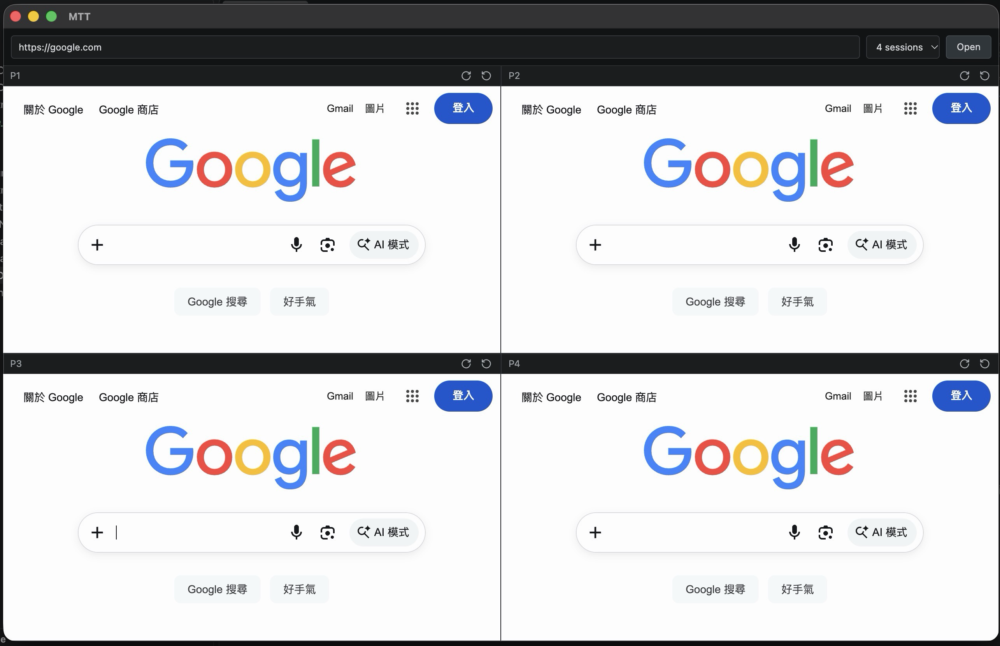

# MTT — MultiTabTesting



MTT runs multiple isolated browser sessions side by side in one desktop window. It is designed for multiplayer web game testing and other workflows that need independent browser storage.

## Features

- One, two, three, four, or six browser sessions in a responsive grid
- Independent cookies and web storage for each session
- Shared URL navigation, with per-session reload and reset
- Per-session network emulation with latency and upload/download limits
- Native Electron `WebContentsView` browser panels

## Requirements

- Node.js 20 or newer
- npm

## Install and run

```sh
npm install
npm run dev
```

Enter an HTTP or HTTPS URL (for example, `http://localhost:3000`), choose a session count, and select **Launch**. The default is four sessions. Use the panel controls to reload one session or clear its browsing state and reopen the current URL.

Each panel's network controls add latency in milliseconds and limit upload or download speed in kilobits per second. A value of `0` leaves that setting unlimited. Taking a panel offline preserves its configured conditions for when it reconnects.

## Development commands

```sh
npm run typecheck
npm run lint
npm run build
```

See [doc/ARCHITECTURE.md](doc/ARCHITECTURE.md) for implementation details and [doc/TODO.md](doc/TODO.md) for planned work.
